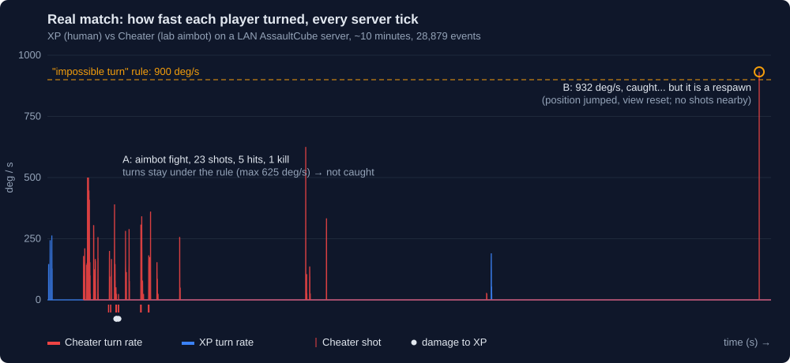
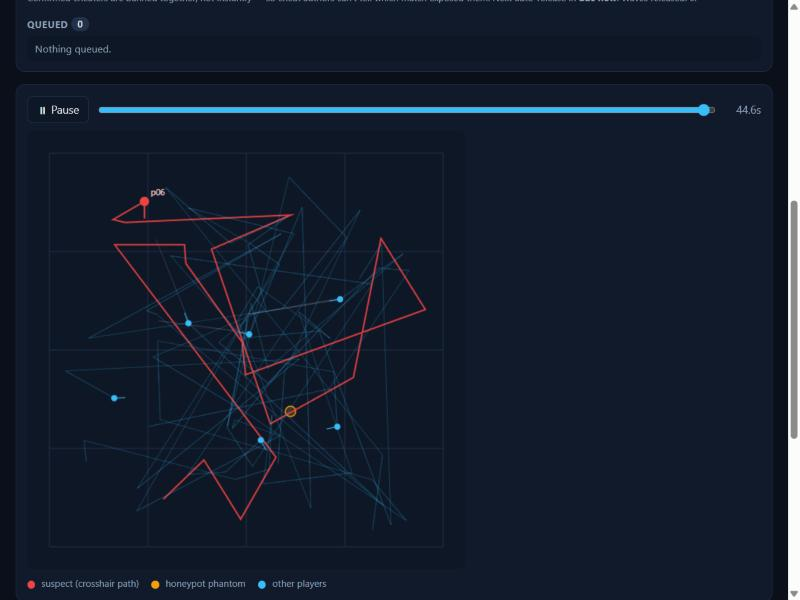
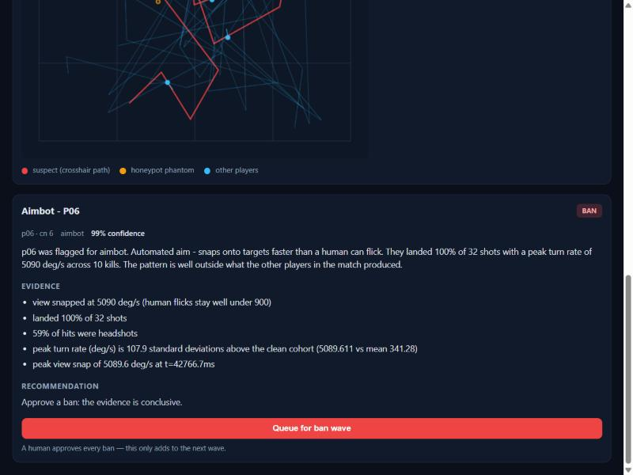

# Aegis AC

**A server-side anti-cheat with an AI SOC analyst, tested on a real game.**


-8a63d2)


Aegis AC runs next to a real **AssaultCube** server (an open-source FPS). The server
streams what it already knows (where each player stands, where they aim, what they
shoot), and Aegis looks for behaviour a human can't produce. Each suspect goes to an
**AI SOC analyst**, which names the likely cheat, checks whether skill could explain it,
and writes a case report. A human makes the final decision.

I tested it on real matches on my own LAN, against a lab cheat client I control. The
results, including what it missed, are below.

---

## How it works

```
  AssaultCube server ──telemetry──▶ collector ──▶ detector ──▶ AI SOC analyst ──▶ human reviewer
  (patched: positions,              (validate,    (features +    (likely cheat type,  (approve, ban wave,
   aim, shots, hits)                 store)        rules)         skill check, case)   Discord)
```

1. **Collect.** An 11-line patch makes the game server send one JSON event per action
   over UDP. The collector validates each event against a strict schema and stores it.
2. **Detect.** Each player becomes a row of measurements: turn speed, accuracy, how close
   the crosshair sits to the enemy when firing, reaction time, whether shots leave where
   the player is looking. Explainable rules turn those into flags with plain-English reasons.
3. **Investigate (SOC).** The analyst (Claude, with read-only tools) answers three
   questions per suspect:
   - **What cheat does this look like?** A ranked list of types, with the evidence for each.
   - **Could a skilled human do this?** `cheat_like` means something no human can do;
     `skill_or_cheat` means strong but humanly possible, which never leads to a ban by
     itself.
   - **What should a person check?** A review checklist for the replay.
4. **Act.** A human approves. Confirmed cheaters go into a delayed ban wave, so cheat
   makers can't tell which match exposed them.

---

## Results on the real game

Full lab report: [docs/LAB.md](docs/LAB.md).



**First run: the detector got it wrong both ways.**
- **A:** during a real aimbot fight (23 shots, 5 hits, 1 kill), turn speed stayed under the
  900 °/s rule, so the aimbot was **not caught**.
- **B:** the player was flagged later, but the 932 °/s "snap" was a **respawn**, not aim.
  It was the right player for the wrong reason, and an honest player could trigger it.

**What I changed, based on the real data:**

| Problem | Fix | Result |
|---|---|---|
| Respawn read as a snap | Skip turns with a position jump > 8 units in one tick (normal movement < 1) | False flag gone; real peak is 625 °/s |
| Turn speed alone misses a smooth aimbot | Measure crosshair-to-enemy distance at each shot | Real aimbot: median **1.4°** lock, labelled *likely aimbot* |
| Can't tell skill from cheating | Skill check + review checklist in every case | Aimbot rounds go to **review**, not to a ban, until real human numbers exist |
| Silent aim / triggerbot not testable | [Telemetry mutation](docs/MUTATION.md): add only a cheat's footprint to a real match | Silent aim caught from **15°** (was 25°) |

**Still weak (and on the list):** a triggerbot needs more engagements than one short
round has. The lock-on rule can be diluted by other shots. A wallhack that aims like a
human is invisible without server-side line-of-sight checks.

---

## The SOC part

What exists today, on real matches:

```powershell
python -m aegis_soc --db data/lab.db --match <match_id> --watch
```

```
CASE: silent aim - Cheater                       (real match + silent-aim footprint at 20°)
Likely types: silent_aim, aimbot      Confidence: 96%      Disposition: BAN
Skill check:  At least one signal cannot be produced by skill: 5 hits landed with the
              shot leaving far from where the player was looking.
Review checklist:
  [ ] Find the listed hits and check the screen: the crosshair should be clearly off the victim.
  [ ] Compare the shot direction with the view angle for those shots.
```

`--watch` also opens cases for players under the flag threshold, such as a very good
player or a careful cheat, so a human sees the borderline ones too.

**Not done yet: the SOC workflow on real matches.** The dashboard, ban waves and Discord
alerts work, but so far only with simulated matches:

| 2D replay: the suspect's aim (red) vs. other players | Case report in the dashboard |
|---|---|
|  |  |

*(Screenshots from a simulated match.)* Next is real matches flowing live into the alert
queue → AI case → human decision → ban wave → Discord. See the [roadmap](docs/ROADMAP.md).

---

## Run it on your own game

You need Windows, Git, Python 3.12, AssaultCube 1.3.0.2 (free) and Visual Studio 2022 Build
Tools. Details: [integrations/assaultcube](integrations/assaultcube).

```powershell
python -m venv .venv ; .\.venv\Scripts\Activate.ps1
pip install -e collector -e detection -e "soc-agent[llm]"
.\integrations\assaultcube\setup.ps1     # build the patched AssaultCube server

# terminal 1: collector (game telemetry on UDP 28800)
$env:AEGIS_DB = "data/lab.db"; uvicorn aegis_collector.app:create_app --factory --port 8000

# terminal 2: patched server (LAN only)
cd assaultcube ; .\bin_win32\ac_server_aegis.exe
```

Join with `/connect localhost` (or from a second PC: [LAN demo](docs/LAN-DEMO.md)). After
playing:

```powershell
python -m aegis_detection.scan --db data/lab.db          # label, likely type, numbers per player
python -m aegis_soc --db data/lab.db --watch             # SOC case reports
```

The Claude analyst runs when `ANTHROPIC_API_KEY` is set. Copy `.env.example` to `.env`;
`DISCORD_WEBHOOK_URL` is optional. Without a key, a rule-based analyst writes the same
kind of case.

To test whether it catches cheaters and not just good players, follow the
[pentest protocol](docs/PENTEST.md). To test cheats you don't have, use
[telemetry mutation](docs/MUTATION.md).

**Optional red team:** a LAN-only lab client with a wallhack and an aimbot, so there's a
real cheater to catch: [redteam/assaultcube-client](redteam/assaultcube-client). You can run
the SOC without ever building it.

---

## Simulator (development only)

Before the game was patched, I built the pipeline against simulated matches. The simulator
is still used for unit tests and for the dashboard demo (**Inject cheater**). On 160
simulated cheaters it catches all of them, with 1 false positive in 480 legit players. Those
are easy numbers on data I generated myself, so the real-game results above are the ones
that count. Details: [docs/SIMULATOR.md](docs/SIMULATOR.md).

---

## Project layout

| Folder | What it is |
|---|---|
| `integrations/assaultcube/` | Telemetry patch for the real AssaultCube server |
| `collector/` | Telemetry ingest (UDP + HTTP), strict schema, SQLite store |
| `detection/` | Measurements, rules, cheat-type / skill check, `scan`, telemetry `mutate` |
| `soc-agent/` | AI SOC analyst, alert queue, ban waves, Discord notifier, dashboard API |
| `dashboard/` | TypeScript + React UI: alerts, case reports, 2D replay, ban waves |
| `redteam/assaultcube-client/` | Optional, LAN-only lab cheat client |
| `data/` | Your local databases (git-ignored) |
| `docs/` | [Lab report](docs/LAB.md) · [Pentest protocol](docs/PENTEST.md) · [Mutation testing](docs/MUTATION.md) · [LAN demo](docs/LAN-DEMO.md) · [Simulator](docs/SIMULATOR.md) · [Roadmap](docs/ROADMAP.md) |

## Safety and ethics

This is a defensive project. The red-team client exists only so that the anti-cheat has a
real opponent in a lab. It's a source change to an **open-source** game, it **refuses to
connect to non-LAN servers** (in code), it always shows an `AEGIS LAB BUILD` watermark, and
it's only built when you opt in. There's no memory reading, injection, driver or bypassing
of any commercial anti-cheat. Silent aim and triggerbots are tested through telemetry
mutation, not by building them.

## Tech stack

Python 3.12 · FastAPI · Pydantic v2 · SQLite · asyncio UDP · pytest · TypeScript · React ·
Vite · Claude (Anthropic SDK) · Discord webhooks · C++ (MSVC) for the game patches

## About me

I'm **Peter D** ([@phugiadang12](https://github.com/phugiadang12)), a recent graduate
looking for my first role in **game security / anti-cheat or SOC**. I built Aegis to learn
how these systems fit together end to end: collecting telemetry, detecting cheats with
rules I can explain, using an AI agent to help with investigations, and testing all of it
against a real game. The most useful lessons came from the parts that didn't work the
first time, and I've written those up in [docs/LAB.md](docs/LAB.md).

## License

Aegis AC's own code is [MIT](LICENSE) © Peter D. The two `.patch` files modify AssaultCube
source code, so they stay under **AssaultCube's licence**. AssaultCube itself isn't included;
the setup scripts download it. Details: [THIRD_PARTY_NOTICES.md](THIRD_PARTY_NOTICES.md).
For responsible use and reporting issues, see [SECURITY.md](SECURITY.md).
