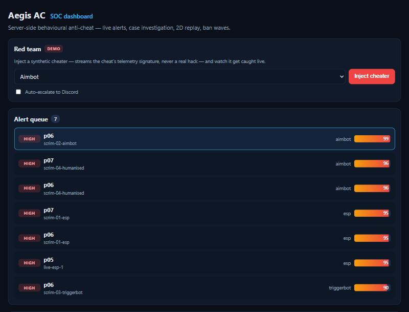
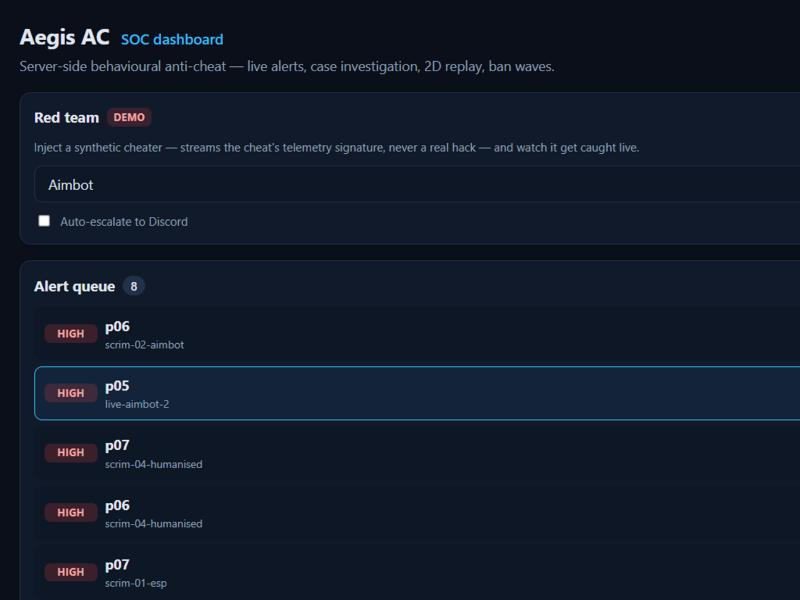

# Aegis AC

**A server-side behavioural anti-cheat for a multiplayer FPS, with an AI SOC analyst.**


-8a63d2)


Aegis AC catches cheaters from the **telemetry a game server already sees** — no kernel
driver, no reading player memory. A behavioural detector flags suspicious players, an
AI analyst investigates each flag and writes a case report, a human approves the ban,
and confirmed cheaters go out in delayed ban waves. Built and validated end to end
against synthetic cheat signatures, then packaged behind a live dashboard.

> **Why I built it.** I'm aiming at game-security / anti-cheat engineering, where the
> interesting problems sit at the intersection of **detection, applied AI, and operations**.
> Aegis is a full, honest slice of that: a telemetry pipeline, an explainable detector, an
> LLM-driven SOC analyst, and an enforcement dashboard — built the way a real team would,
> without ever shipping a real cheat.



---

## Highlights

- **Server-side, privacy-preserving.** Works from position/aim/shot telemetry on trusted
  hardware — no client driver, nothing to reverse-engineer on the player's PC.
- **100% detection, 99% precision** over 160 cheaters + 480 legit players on labelled
  synthetic matches (1 false positive).
- **A honeypot that catches a human-aim wallhack.** A server-only phantom entity no
  legitimate client can see — anyone who aims at it is reading state they shouldn't have.
- **An AI SOC analyst.** A tool-using Claude agent investigates each alert and files a case
  report (category, confidence, disposition, evidence, recommendation); a human approves.
  Runs fully offline with a deterministic backend when no API key is set.
- **Live enforcement dashboard** (TypeScript + React): alert queue, 2D replay viewer,
  delayed ban waves, and Discord alerts.
- **A rule-safe live demo.** An "Inject cheater" control spawns a synthetic cheater on
  demand and shows the whole pipeline catch it — safe to run in front of anyone.
- **81 tests**, three Python packages, a typed frontend that builds clean.

---

## Architecture

```
 AssaultCube server (to be patched)       Aegis AC
 ┌──────────────────────────┐   UDP   ┌─────────────┐   ┌─────────────┐
 │ player pos / aim / shots │ ──────▶ │  collector  │──▶│  detection  │
 │ honeypot "ghost" entity  │  JSONL  │  (FastAPI)  │   │ rules+honey │
 └──────────────────────────┘         └─────────────┘   └──────┬──────┘
          ▲                                                    │ alerts
          │ kick / ban wave                                    ▼
 ┌────────┴────────┐    approve     ┌─────────────┐    ┌─────────────┐    ┌──────────┐
 │   enforcement   │ ◀───────────── │  dashboard  │ ◀──│  SOC agent  │──▶ │ Discord  │
 └─────────────────┘                │ + 2D replay │    │   (Claude)  │    └──────────┘
                                    └─────────────┘    └─────────────┘
```

| Package | What it does |
|---|---|
| `collector/` | Ingests telemetry (UDP + HTTP), validates a strict schema, stores events (SQLite). Includes the legit-player and synthetic-cheater simulators. |
| `detection/` | Feature extraction, explainable rule-based detection, the honeypot logic, and a scoring harness. |
| `soc-agent/` | The AI SOC analyst, the alert queue, ban-wave enforcement, the Discord notifier, and the dashboard's analysis API. |
| `dashboard/` | TypeScript + React UI: alerts, case panel, 2D replay viewer, ban waves, live red-team control. |
| `docs/` | [Roadmap](docs/ROADMAP.md) and design notes. |

---

## How it works

1. **Telemetry pipeline.** A game server streams one JSON event per line — joins, ticks
   (position + aim), shots, damage, kills, and the honeypot. The collector ingests over UDP
   (fast path) and HTTP, rejecting unknown fields, and stores raw events so any detector can
   replay a match. (Fixed a 27% → 0% UDP packet-loss cliff with an 8 MB receive buffer.)
2. **Red team, done safely.** Rather than run a real cheat, Aegis describes each cheat
   mathematically and emits the telemetry it would leave — labelled with ground truth. This
   is how anti-cheat teams actually develop detectors. No memory reading, no injection, no
   kernel evasion.
3. **Detection.** Each match becomes one feature row per player (peak/sustained turn rate,
   hit rate, headshot rate, honeypot shots). Explainable rules flag cheats, and every flag
   carries a human-readable reason the AI analyst later quotes.
4. **AI SOC analyst.** A Claude agent investigates each alert with read-only tools — stats
   overview, a z-score baseline vs. the lobby's clean players, the sharpest view-snaps, the
   honeypot evidence — then files a case with a recommendation. Never auto-bans.
5. **Enforcement.** The dashboard shows alerts, cases and a 2D replay; confirmed cheaters go
   into delayed ban waves (so authors can't correlate a ban to a match), and Discord pings
   the team.

### Detection results

| Feature | Cheat tell |
|---|---|
| `max_turn_rate` | aimbot snap (completes inside one tick) |
| `p95_turn_rate` + `hit_rate` | humanised aimbot |
| `hit_rate` | triggerbot / aimbot (lands almost everything) |
| `honeypot_shots` | ESP / wallhack (aimed at a server-only phantom) |

**100% detection, 99% precision** over 160 cheaters and 480 legit players. The ESP
wallhacker aims like a human and evades every aim-based rule, yet the moving honeypot
phantom still exposes it.

---

## Screenshots

| 2D replay viewer | AI SOC case report |
|---|---|
|  |  |

The suspect's crosshair path (red) against the other players (blue), with the honeypot
phantom in amber — a wallhacker's aim at an invisible target is visible at a glance. Each
flag becomes a reviewed case with a confidence and a recommendation.

---

## Quick start

Requires Python 3.12 and Node 18+. A virtualenv is recommended.

```powershell
python -m venv .venv ; .\.venv\Scripts\Activate.ps1
pip install -e collector -e detection -e soc-agent
pytest                                   # 81 tests
```

### Collector + simulated telemetry

```powershell
uvicorn aegis_collector.app:create_app --factory --port 8000     # terminal 1
python -m aegis_collector.sim --players 8 --seconds 60            # terminal 2
```

### Detection

```powershell
python -m aegis_detection.evaluate --matches 20   # score vs ground truth
```

### AI SOC analyst (offline by default)

```powershell
python -m aegis_soc --profile esp                 # investigate a match's alerts
# optional: set ANTHROPIC_API_KEY to let a Claude agent drive the investigation
```

### Dashboard + Discord alerts

```powershell
# terminal 1 — analysis API (seeds demo matches; set the webhook to alert Discord)
$env:DISCORD_WEBHOOK_URL = "https://discord.com/api/webhooks/…"
uvicorn aegis_soc.api:create_app --factory --port 8008

# terminal 2 — dashboard (proxies /api to :8008)
cd dashboard ; npm install ; npm run dev          # http://localhost:5173
```

Copy `.env.example` to `.env` to keep the webhook and keys out of the shell (and out of git).

### Live red-team demo



In the dashboard, pick a profile and click **Inject cheater** (or
`POST /api/redteam/inject?profile=aimbot&escalate=true`): a fresh match with a synthetic
cheater is spun up, a new alert appears on screen, and — with auto-escalate — Discord is
pinged. It streams the cheat's telemetry *signature*, never a real hack, so it's safe to
run live and needs no game attached.

---

## Safety & ethics

Aegis never ships a real cheat. The "red team" generates the telemetry *signatures* a cheat
would leave — labelled with ground truth to score the detector — with **no memory reading,
no injection, and no kernel evasion**. It targets AssaultCube (open-source) on a **private,
local server**, never commercial games or public servers. This is deliberate: a real cheat
would add nothing to the research and would violate game ToS. "I generate the signature, not
the hack" is the honest, professional way to build and prove a detector.

---

## Tech stack

Python 3.12 · FastAPI · Pydantic v2 · SQLite (WAL) · asyncio UDP · pytest ·
TypeScript · React · Vite · Claude (Anthropic SDK) · Discord webhooks

See [docs/ROADMAP.md](docs/ROADMAP.md) for the phased build plan and what's next (patching
the AssaultCube server for live telemetry; routing alerts to Zalo / Grafana).

---

## About the author

Built by **Peter D** ([@phugiadang12](https://github.com/phugiadang12)) as a portfolio
project for **game-security / anti-cheat and applied-AI engineering** roles. It's meant to
show the whole arc of the work: designing a detection pipeline, generating labelled data
safely, building an explainable detector, applying an LLM agent to security operations, and
shipping it behind a usable dashboard — with tests at every layer.

## License

[MIT](LICENSE) © Peter D
