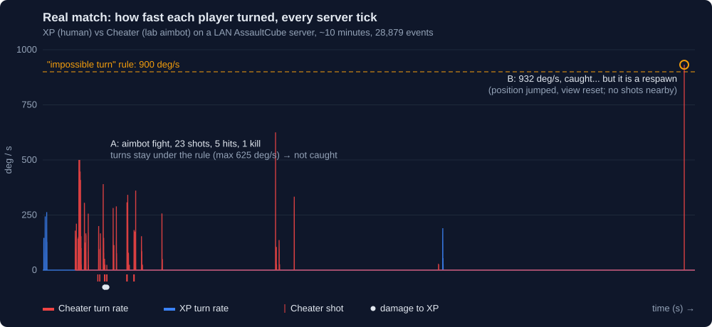

# Live lab report: testing Aegis on a real game

**Short version:** I connected Aegis to a real AssaultCube match and played a real
aimbot against a human. The pipeline worked end to end. The detector did **not** catch
the aimbot during the fight, and later flagged the cheater **for the wrong reason** (a
respawn). Both problems, and how I plan to fix them, are below.

---

## 1. The setup

Everything ran on one Windows PC.

```
  XP (normal client, human)  ─┐
                              ├─▶ AssaultCube server ──UDP──▶ Aegis collector ──▶ detector
  Cheater (lab cheat client) ─┘   + telemetry patch          (data/lab.db)        (scan)
```

| Part | What it does | Folder |
|---|---|---|
| Telemetry patch | 11 lines in the game server, plus one header file. Sends joins, positions and aim (~30 per second), shots, damage, kills and leaves | [`integrations/assaultcube`](../integrations/assaultcube) |
| Lab cheat client | Wallhack and aimbot, with an Insert menu for strength and FOV. Works on LAN only | [`redteam/assaultcube-client`](../redteam/assaultcube-client) |
| Collector + detector | The same code used on the simulated matches, unchanged | `collector/`, `detection/` |

## 2. What I checked

| Question | Answer | Evidence |
|---|---|---|
| Does real game telemetry reach Aegis? | Yes | 28,879 events in one 10-minute match, **0 rejected** by the schema |
| Does a human stay clean? | Yes | XP: suspicion 0.00 in every match, peak turn 263 °/s |
| Is the aimbot caught during the fight? | **No** | 23 shots, 5 hits, 1 kill. Peak turn during the fight was 625 °/s, under the 900 °/s rule |
| Is the cheater flagged at all? | Yes, but for the wrong reason | The 932 °/s "snap" was a respawn, not aim (see section 3) |
| Can the server spot a modified client? | A hint, yes | Server log: `Cheater logged in … AC: -1302`. Stock clients report `1302` |

Re-run it yourself with `python -m aegis_detection.scan --db data/lab.db`.

## 3. The chart



The chart shows how fast each player turned their view, measured every server tick
(about 30 times a second).

- **A: the aimbot fight.** The cheater's turns (red) line up with its shots and the
  damage it dealt, but they never cross the 900 °/s line. **Not caught.**
- **B: the "catch".** One tick shows 932 °/s. Looking at the raw data, in that same
  tick the cheater's **position jumped about 58 units and the view reset to 45°**, and
  there were no shots nearby. That is a respawn. A normal player respawning could set off
  the same rule, so this is a **false-positive risk** as well as a lucky catch.

## 4. Why the detector missed

| # | Cause | What I learned |
|---|---|---|
| 1 | The 900 °/s limit came from my simulator | The real server only sees aim ~30 times a second, so a smoothed aimbot finishes its turn between two updates and measures as ~600 °/s. Rules need to be tuned on real data |
| 2 | Respawns look like snaps | The detector must ignore view changes when the player teleports, spawns or dies |
| 3 | Idle time hides the signal | Most ticks are standing still, so the "95th percentile turn rate" was 0 for everyone. Turn stats should only use moments of fighting |
| 4 | Not enough data for accuracy rules | 5 hits is under the 6-hit minimum (a guard against false positives). Longer rounds will help |
| 5 | Wallhack is invisible to the server | ESP only changes the cheater's own screen. It needs line-of-sight checks or a honeypot target sent by the real server |

## 5. Bugs the real game exposed in my patch (fixed)

| Bug | What happened | Fix |
|---|---|---|
| Map change froze telemetry | The game clock restarts at 0 on each map, so my 30 Hz limiter dropped every update after the first map | A new map now starts a new match (`ac-<time>-<round>`) and resets the limiter |
| Cheat client sent fake events | The client has a built-in offline server, and it ran the telemetry hooks too | Telemetry is compiled into the dedicated server only |
| Player missing from a match | A player who connected but never spawned only produced a "leave" event | Open: send "join" on connect |

## 6. Next steps

**Fix the detector (on real data):**
- [ ] Ignore turn rate across respawns and teleports (position jump in one tick)
- [ ] Record clean human games on real maps and tune the thresholds from them
- [ ] Measure turn speed only around fights, and add a "snap then stop" feature
- [ ] Record real headshots, and send "join" when a player connects
- [ ] Honeypot target sent by the real server, and line-of-sight checks for wallhacks

**Then SOC + testing:**
- [ ] A test grid: aimbot strength (100 / 35 / 15) × FOV (180 / 30 / 10) × wallhack on/off,
      each round labelled → a chart of "how subtle can the cheat be before Aegis misses it?"
- [ ] Send real matches through the dashboard, AI analyst, ban wave and Discord
- [ ] Save these real matches as regression tests, so fixed bugs stay fixed
