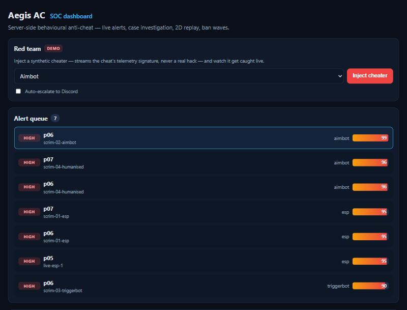
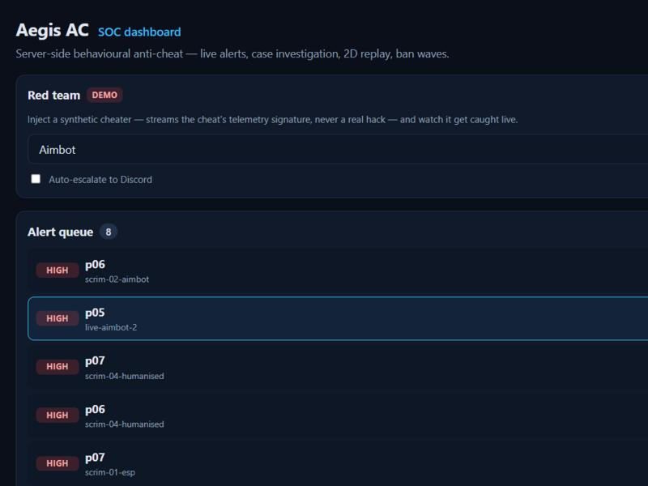

# Simulator (development only)

Before the AssaultCube server was patched, I built and tested the pipeline against
simulated matches. The simulator is kept for three things:
- **unit tests**, which need labelled data with a known answer;
- **the dashboard demo**: **Inject cheater** creates a cheater on demand;
- **regression checks**: if a rule change suddenly raises false positives here, something
  is wrong. This caught a real bug in the silent-aim fix (see [MUTATION.md](MUTATION.md)).

The real-game results in the [README](../README.md) and [LAB.md](LAB.md) are the ones that
matter. The simulated numbers are easy, because I generated the data myself.

## What it simulates

Legit players have human limits: turn speed, reaction delay, aim noise, 25–55% accuracy.
Each cheat profile changes only that player's aim and firing:

| Profile | Behaviour |
|---|---|
| `aimbot` | Instant snap onto the target every tick |
| `humanised` | Snap spread over 3–5 ticks with jitter |
| `triggerbot` | Fires the instant the crosshair crosses an enemy |
| `esp` | Human aim, but tracks enemies through walls and is lured by the honeypot phantom |

## Run it

```powershell
pip install -e collector -e detection -e soc-agent
pytest                                                   # 98 tests

python -m aegis_detection.evaluate --matches 20          # detector score vs ground truth
python -m aegis_soc --profile esp                        # analyst on a simulated match

uvicorn aegis_soc.api:create_app --factory --port 8008   # terminal 1: analysis API
cd dashboard ; npm install ; npm run dev                 # terminal 2: http://localhost:5173
```



**Inject cheater** in the dashboard adds a simulated cheater on demand:



## Score

```
profile             detect  precision  FP rate   TP  FN  FP   TN
aimbot                100%       100%       0%   40   0   0  120
humanised             100%       100%       0%   40   0   0  120
triggerbot            100%       100%       0%   40   0   0  120
esp                   100%        98%       1%   40   0   1  119
OVERALL               100%        99%       0%  160   0   1  479
```

The one useful lesson from this data: the ESP player aims like a human, so every aim rule
misses it. It's only caught by the honeypot, a phantom target that only a wallhack can
see. On the real game there's no honeypot yet, which is why a real wallhack goes
unnoticed (LAB.md §4.5).
